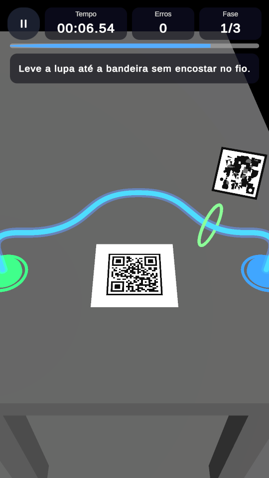

# Circuit AIR · disciplina_RV_2026_2_t2_equipe_4

Jogo do fio ("circuito elétrico") em **realidade aumentada**. A câmera do celular encontra o QR Code
impresso sobre a mesa e mostra um circuito virtual em cima dele. O jogador passa a **lupa física**
(um aro com cabo) ao longo do fio sem encostar. O app conta o tempo, os toques no fio e as saídas do
fio, e mostra o resultado no final.

Equipe (Ciência da Computação): Rian Gustavo Atanagildo, Julio Cesar Vanz, Larissa Sindy Makufka
Schlichting e Lucas Edgar Cardoso.

O planejamento atualizado está em [PlanejamentoAplicativo_reestruturado.pdf](PlanejamentoAplicativo_reestruturado.pdf)
(o original continua em [PlanejamentoAplicativo.pdf](PlanejamentoAplicativo.pdf)).



## Tecnologias

| Item | Versão |
|---|---|
| Unity | 6.3 LTS (6000.3.24f1), Universal Render Pipeline |
| Linguagem | C# |
| Realidade aumentada | AR Foundation 6.3 + ARCore XR Plugin 6.3 (Android) + ARKit XR Plugin 6.3 (iOS) |
| Teste no PC | XR Simulation (vem com o AR Foundation) |
| Interface | uGUI + TextMeshPro, montada por código |
| Testes | Unity Test Framework (21 testes de modo Editor) |

## Como jogar

1. Imprima a folha [docs/Marcadores_para_imprimir.pdf](docs/Marcadores_para_imprimir.pdf) em **tamanho real (100%)**:
   o QR Code tem de sair com **10 cm** e o marcador da lupa com **5 cm**.
2. Cole o marcador da lupa num cartão rígido e prenda **em pé no cabo da lupa, como uma bandeirinha**
   (perpendicular ao aro), com a **borda do quadrado preto virada para o aro**.
3. Coloque o QR Code na mesa e o celular num **suporte ou tripé** apontado para ele, a uns 40 a 60 cm.
   O circuito aparece sobre o QR Code e fica **ancorado**: a mão ou a lupa podem passar por cima do QR Code
   que o percurso não some nem se mexe.
4. Na primeira vez, toque em **Ajustar lupa**, segure a lupa na frente da câmera e use os botões até o
   contorno azul ficar exatamente em cima do aro real. O ajuste fica salvo no celular.
5. Toque em **INICIAR**, encaixe o aro no fio dentro do **anel verde** (o tempo começa) e leve até a bandeira.

Regras:

- Cada vez que o aro **encosta** no fio conta 1 erro: o fio pisca em vermelho, toca um zumbido e o celular vibra.
- Se o aro **sai do fio** conta 1 erro e aparece um **anel amarelo**: é preciso voltar a esse ponto para continuar
  (não dá para "pular" um trecho do circuito).
- Ao chegar na bandeira aparecem o tempo final, os erros (toques e saídas) e o recorde da fase.
- Há 3 fases (Aquecimento, Ondas e Desafio), recordes salvos no aparelho, pausa e reinício.
- Sem lupa física, toque em **"Lupa: física"** no menu para usar a **lupa virtual**, presa à câmera do celular.

## Por que a lupa "não ia" antes

Na versão que estava no repositório:

1. O `CircuitARController` esperava uma imagem chamada `LupaMarker` para encontrar a lupa, mas a biblioteca
   de imagens só tinha o `CircuitQR`. A lupa nunca era reconhecida.
2. O modelo `Lupa_CircuitAIR.obj` está em milímetros e era importado como se fosse em metros: a lupa tinha
   400 m e ficava parada na origem da cena, sem ligação com o rastreamento.
3. O `Packages/manifest.json` apontava para dois pacotes que não estão no repositório (o `.tgz` do Vuforia,
   ignorado pelo `.gitignore`, e o `xr-sim-environments` numa pasta `ContentPackages` fora do projeto),
   o que quebrava a abertura do projeto. A cena `CircuitAIRScene` dependia do Vuforia sem licença.
4. A cena não tinha o `CircuitGameManager` nem interface (os textos do TextMeshPro nem tinham fonte importada).

Tudo isso foi corrigido. O projeto voltou a usar **só AR Foundation**, como pede o planejamento
(o [guia de migração para Vuforia](GuiaMigracaoVuforia.md) ficou como histórico).

## Abrir e testar no PC

1. Abra a pasta `CircuitAir` no Unity **6000.3.24f1** (Unity Hub > Add > pasta `CircuitAir`).
2. Abra a cena `Assets/Scenes/CircuitAIR.unity` e aperte **Play**. O XR Simulation carrega uma mesa
   virtual com o QR Code e um marcador de lupa (`Lupa simulada (LupaMarker)`).
   - Mova a câmera com o botão direito do mouse + W, A, S, D, Q, E.
   - Para testar a lupa física, selecione `Lupa simulada (LupaMarker)` na cena do ambiente simulado e mova-a.
   - Em **Edit > Preferences > General**, deixe **Script Changes While Playing** em
     *Recompile After Finished Playing* (exigido pelo XR Simulation).
3. Testes: **Window > General > Test Runner > EditMode > Run All** (21 testes; incluem a garantia de que as 3
   fases podem ser completadas sem encostar com aros de 3 a 7 cm).

Se algo da cena ou das configurações for apagado sem querer, o menu **CircuitAIR > 2. Configurar projeto e cena**
refaz tudo (biblioteca de imagens, materiais, cena, Player Settings e plug-ins de XR).

## Gerar o app

**Android** (precisa do módulo *Android Build Support* com SDK, NDK e OpenJDK instalado no Unity Hub):
File > Build Profiles > Android > Switch Platform > Build. O projeto já está configurado:
`com.equipe4.circuitair`, IL2CPP + ARM64, OpenGL ES 3, Android 7.1+ (API 25), ARCore obrigatório, retrato.
O celular precisa estar na [lista de aparelhos compatíveis com ARCore](https://developers.google.com/ar/devices).

**iOS** (precisa de um Mac com Xcode e do módulo *iOS Build Support*): Build Profiles > iOS > Build, abra o
projeto gerado no Xcode, escolha a equipe de assinatura e rode no iPhone. A descrição de uso da câmera já está
configurada. O ARKit rastreia imagens em movimento melhor que o ARCore, então o iPhone tende a seguir a lupa
física com menos atraso.

## Estrutura

```
CircuitAir/Assets/
  CircuitAIR/
    Scripts/
      AR/CircuitARController.cs     Rastreia o QR Code (circuito) e o LupaMarker (lupa); ancora o circuito.
      Circuit/WirePath.cs           Caminho do fio (pontos, curvas arredondadas, distância ao longo do fio).
      Circuit/WireRingMath.cs       Geometria aro x fio: encostou? o fio passa por dentro do aro?
      Circuit/CircuitLevels.cs      As 3 fases (pontos do fio em metros).
      Circuit/CircuitWire.cs        Monta o circuito: fio luminoso, bases, bandeira, anéis verde e amarelo.
      Circuit/TubeMesh.cs           Malhas por código (tubo, disco, toro).
      Circuit/CircuitTheme.cs       Materiais e malha da lupa (asset CircuitAIR_Theme).
      Lupa/LupaController.cs        Lupa física (marcador + calibração) ou virtual (presa à câmera).
      Game/CircuitGameManager.cs    Regras: início, tempo, toques, saídas, anti-pulo, chegada, recordes.
      Game/CircuitFeedback.cs       Sons gerados por código e vibração.
      Game/CircuitRecords.cs        Recordes por fase (PlayerPrefs).
      UI/CircuitUI.cs               Telas: menu, placar, pausa, resultado, níveis, recordes, ajuste da lupa.
    Editor/CircuitProjectSetup.cs   Menu CircuitAIR: configura cena, materiais, Player e XR.
    Editor/LupaMarkerGenerator.cs   Gera a imagem do marcador da lupa.
    Tests/Editor/WireRingMathTests.cs
    Marcadores/                     CircuitQR.jpg (10 cm) e LupaMarker.png (5 cm). Nota 100 no arcoreimg.
    AR/CircuitAIR_ImageLibrary.asset
  Scenes/CircuitAIR.unity           Cena única do app.
  CircuitAIR_enviroment.prefab      Mesa virtual do XR Simulation.
docs/
  Marcadores_para_imprimir.pdf
  imagens/                          Capturas das telas.
```

## Ajustes finos

No Inspector do objeto `Lupa` (filho da câmera) e do `CircuitAIR (Jogo)`:

| Campo | Para quê |
|---|---|
| `Lupa > Physical Ring Radius` | Raio do aro real (metade do diâmetro, no meio do arame). Também ajustável no app. |
| `Lupa > Marker To Ring Offset / Tilt` | Onde o aro fica em relação ao marcador. Também ajustável no app (Ajustar lupa). |
| `Lupa > Marker Grace Seconds` | Quanto tempo a lupa continua valendo quando o marcador some por um instante. |
| `Jogo > Error Cooldown Seconds` | Tempo mínimo entre dois erros. |
| `Jogo > Rejoin Tolerance Meters` | Quanto à frente do anel amarelo ainda vale voltar ao fio. |
| `Jogo > Max Speed Meters Per Second` | Velocidade máxima ao longo do fio (acima disso é "pulo"). |
| `CircuitLevels.cs` | Pontos de cada fase, raio do fio e das curvas. |
